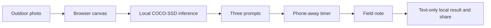

*This is a submission for the [Hacktoberfest Open-Source AI Challenge Week 1: Touch Grass](https://dev.to/challenges/hacktoberfest-week1-2026-10-05).*

## What I Built

Three Things Outside is a small mobile web exercise: take one outdoor photo, let an open-source object detector suggest three ways to look more closely, then put the phone away for three minutes. The last prompt always asks what the AI missed. After the timer, the person writes one field note. It is for anyone who wants a reason to stop identifying everything on a screen and pay attention outside.

The interesting result should be the human note, not the model's labels.

The screenshots show a 15-second judge-demo countdown and a completed note reading “a smell after rain.” They show the interaction, but I have not documented a verified outdoor field test, so I will not present them as proof of one. In the repeatable public-site test, a synthetic PNG gave the model no confident objects. The app said so plainly and still offered three prompts, including one about what lay beyond the frame. That is the behavior I wanted: an imperfect model can start an observation without pretending it saw everything.

## Demo

**Live HTTPS demo:** https://main.dkm0k3epi65hg.amplifyapp.com/

**Screenshot 1 — 15-second judge timer:** 

**Screenshot 2 — completed field note:** 

For judges, the same flow has a clearly labeled 15-second demo mode after photo analysis. The standard exercise is three minutes.

## Code

**GitHub repository:** https://github.com/ABhattacharya-dev/three-things-outside

Run locally with `python -m http.server 8000`, then open `http://localhost:8000/`. The repository README explains the full journey, test checklist, limitations, and deployment.

## How I Built It

The app is buildless HTML, CSS, and JavaScript. TensorFlow.js 4.22.0 runs COCO-SSD 2.2.3 in the browser with its `lite_mobilenet_v2` base. A selected JPEG, PNG, or WebP up to 12 MB is decoded into a canvas scaled to at most 960 pixels on its longest edge. Local inference yields up to three classes scoring at least 50%, or an honest empty result. The detections shape the first prompt. The second asks for a sensory detail. The third asks what AI missed. A wall-clock timer sends the person away from the phone; a field note closes the loop. The latest text result uses browser `localStorage`; sharing uses Web Share with a selectable text fallback.

The app contains no photo upload path or backend. The temporary photo URL is revoked and the preview canvas is cleared after inference. Only the latest note text, completion time, and detected class names go into `localStorage`; a blocked store leaves the note usable until reload. The first visit requires downloads of the libraries and model, so this is not an offline-first app. The model can be wrong and must never be treated as a safety or species identifier. A browser Network capture is still needed before claiming the no-upload property was independently verified.

**Local audit, October 11:** The four browser self-checks passed. The pinned model loaded and analyzed a tiny valid PNG in a desktop browser, producing the honest zero-detections path. At desktop and 320 px simulated mobile widths, no horizontal overflow appeared; keyboard focus reached the skip link and file input. Temporary local stubs verified confident detection display, failed model loading with Retry, failed inference with Retry, unsupported/corrupt/oversized image errors, blocked storage, restart, and text-only share fallback. Both the full three-minute timer and 15-second judge mode reached the field-note screen. The synthetic images and stubbed detections are test fixtures, not outdoor evidence.

**Public HTTPS audit, October 11:** An Amplify manual deployment contained only the three runtime files. Requests for the README, DEV draft, project instructions, and self-check page returned 404. In a fresh browser tab at the public URL, the pinned model became ready, analyzed a valid synthetic PNG with zero confident detections, produced three prompts, completed the full 15-second judge timer, and saved a field note. The synthetic image is a technical fixture, not outdoor evidence.

**Still to verify:** physical mobile Chrome and camera permission, a real outdoor image and three-minute phone-away run, a reduced-motion device setting, native Web Share, and a Network capture showing no photo upload.

## Why Does Open Innovation Matter?

An inspectable, replaceable open-source detector makes the photo-to-prompt loop possible without a private inference API. There is no per-image API fee and no account. Because the model's limited object vocabulary is visible, its misses become part of the experience: the person can notice sounds, changes, and details that a single frame cannot capture. Local inference makes a private-photo design possible while keeping the screen part short.

## My Agent Session

This [public curated DevRelay build and verification session](https://dev.to/agent_sessions/799) records selected, paraphrased milestones. It contains no raw tool logs, private machine paths, credentials, or photos.



## Credits and disclosure

The app uses [TensorFlow.js](https://github.com/tensorflow/tfjs), [COCO-SSD](https://github.com/tensorflow/tfjs-models/tree/master/coco-ssd), and its [COCO object classes](https://cocodataset.org/). Project code is MIT licensed; upstream code, model weights, and data keep their own licenses. Codex AI produced this article and substantial project code at the project owner's request. The post is marked `fully_autonomous` in DEV's AI disclosure. The two screenshots were supplied by the project owner; no real outdoor-test account was provided.
