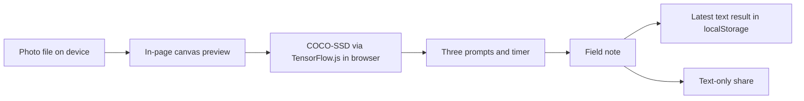

# Three Things Outside

A small outdoor observation exercise for the [Hacktoberfest 2026 Week 1 “Touch Grass” challenge](https://dev.to/challenges/hacktoberfest-week1-2026-10-05). Take one photo, let local object detection suggest what to observe, then put the phone away for three minutes. Finish with one thing the model missed.

## Run locally

From this folder, run one command:

```sh
python -m http.server 8000
```

Open <http://localhost:8000/> in current Chrome. Python's server is only for local testing; no Python package or build step is required. `self-check.html` runs four pure-logic checks without downloading the AI libraries. On a phone, deploy to HTTPS before testing the camera. The 15-second judge demo button appears after analysis and follows the same flow as the three-minute exercise.

## What happens

1. TensorFlow.js 4.22.0 and COCO-SSD 2.2.3 load from pinned jsDelivr URLs. COCO-SSD then downloads its model. Photo selection waits for successful model loading.
2. A selected JPEG, PNG, or WebP (maximum 12 MB) is decoded into a canvas and scaled to at most 960 pixels on its longest edge. COCO-SSD infers in the current page. The app shows up to three classes with scores of at least 50%; an empty result is reported honestly.
3. Exactly three prompts ask about a detected object when possible, a sensory detail, and something AI missed. A timer uses a wall-clock deadline, so switching away from the tab does not pause it.
4. After the timer, a short field note makes a completion card. Only the note text, completion timestamp, and detected class names are stored as the latest result in `localStorage`. Sharing uses text-only Web Share or a selectable text box when sharing is unavailable.

The model can be wrong. It is **not** a species or safety identifier. Never use its output to decide whether a plant, animal, place, or object is safe.

## Privacy and cost

The photo is not uploaded or stored. Its temporary object URL is revoked after analysis, when another photo replaces it, or on restart. The preview canvas is cleared after inference. There is no account, geolocation, analytics, backend, API key, or paid inference endpoint. First load requires internet to download libraries and model assets; this project does not promise offline use. Inference after loading runs locally in the page. `localStorage` can be blocked; completion and text sharing still work for that page session. Browser cache behavior for public libraries and model files is controlled by the browser.

The app has **$0 per-inference API cost**. The public demo is hosted on AWS Amplify; hosting may have usage-based charges beyond its free allocation. The repository itself contains no deployment credentials or infrastructure automation. When the demo is no longer needed, delete the Amplify app in the AWS console or run `aws amplify delete-app --app-id dkm0k3epi65hg` to stop that resource.

## Architecture



## Audit evidence (October 11, 2026)

The project was served from this folder over local HTTP and inspected in the Codex in-app Chromium browser at a desktop-sized viewport and 320 px. `self-check.html` passed all four prompt, detection-filter, and timer checks, including a final rerun. JavaScript syntax passed `node --check app.js` again before deployment. Both viewports had document scroll width equal to client width, with no horizontal overflow. Keyboard Tab reached the skip link and file input, and the focused skip link had a visible outline.

The pinned libraries and real COCO-SSD model loaded in the browser. A tiny valid PNG was decoded and analyzed by the real model, which correctly followed the zero-confident-detections path and produced three prompts. Temporary local stubs exercised a positive detection result (bench 91%, bird 78%), model-load failure and Retry, inference failure and Retry, unsupported text input, corrupt PNG, oversized PNG, blocked `localStorage`, missing Web Share, and restart. The 15-second demo reached the field note and produced a selectable text-only summary with truthful demo wording. The full three-minute timer reached the field-note screen. A saved note appeared after reload. Temporary audit fixtures were removed after the run.

These were desktop browser and simulated viewport checks. A physical phone camera, current mobile Chrome, browser permission prompts, real outdoor image, screen-lock return, Web Share on a supported device, and the reduced-motion preference were **not** exercised. The CSS includes a `prefers-reduced-motion: reduce` rule, but the audit browser reported no reduced-motion preference. No network capture was made to independently verify the no-upload claim; the source contains no photo upload request or form submission.

## Remaining test checklist

- On a physical phone in current Chrome, grant the camera permission if prompted, capture a real outdoor photo, and complete the full three-minute exercise after locking or backgrounding the phone.
- Inspect the page with a reduced-motion OS preference and confirm focus and scrolling remain usable. Check readable contrast and controls on the physical screen.
- Test native Web Share on a supported device. The selectable text fallback was tested with Web Share unavailable.
- In browser Network tools, confirm photo bytes are never sent and no request is made during inference. The page does request public libraries and model assets on initial load.
- Review the two screenshots and public code and HTTPS demo links, then record the honest outdoor result in the DEV draft.

## Public demo and repository

- **Live HTTPS demo:** https://main.dkm0k3epi65hg.amplifyapp.com/
- **GitHub repository:** https://github.com/ABhattacharya-dev/three-things-outside
- **Screenshots:** [15-second judge timer](https://raw.githubusercontent.com/ABhattacharya-dev/three-things-outside/main/assets/Screenshot1.png) · [completed field note](https://raw.githubusercontent.com/ABhattacharya-dev/three-things-outside/main/assets/Screenshot2.png)
- **Curated DevRelay session:** https://dev.to/agent_sessions/three-things-outside-curated-build-and-verification-session-kq5qyi (currently an unpublished session draft)

The static Amplify manual deployment contains only `index.html`, `styles.css`, and `app.js` at the archive root. There is no build command. Requests for `README.md`, `DEV_SUBMISSION.md`, `AGENTS.md`, and `self-check.html` returned 404 on the public host. The public browser loaded the real model and completed the 15-second flow with a valid synthetic PNG and zero confident detections. No AWS SDK or browser credentials are shipped.

## Limitations and credits

COCO-SSD recognizes a fixed set of common objects, not subtle outdoor details, species, hazards, or context. Scores are model confidence estimates, not guarantees. Large or unusual image formats are rejected. Model download and first inference may be slow on mobile devices; availability depends on CDN/network access. A browser may suspend visual updates while the phone is locked, but the deadline is recalculated when it resumes. There is one latest note, with no history or sync.

Built with [TensorFlow.js](https://github.com/tensorflow/tfjs) 4.22.0 and [COCO-SSD](https://github.com/tensorflow/tfjs-models/tree/master/coco-ssd) 2.2.3, using the COCO-SSD `lite_mobilenet_v2` base trained for the [COCO object classes](https://cocodataset.org/). Project code is MIT licensed; upstream libraries, model weights, and data retain their own licenses. Interface copy, flow, code, and the initial DEV draft were produced with Codex AI assistance. A human must verify the final code, claims, and field-test account before publication.

## Submission status

Week 1 closes **October 12, 2026 at 06:59 UTC / 12:29 PM IST**. The app is deployed and its source is public, but no DEV entry has been created or submitted. The challenge requires a new project built during the entry window and one English DEV submission using the official template and the `hf26challenge` tag; this draft also includes `devchallenge`. Before entering, the user must confirm they meet the [official eligibility rules](https://dev.to/page/official-hackathon-rules), including age, location, and DEV membership. `DEV_SUBMISSION.md` still needs the human outdoor account; the saved agent session must be made public if judges are to open its link. Preserve a one-hour buffer before the deadline; any commits after the deadline must be noted here.
